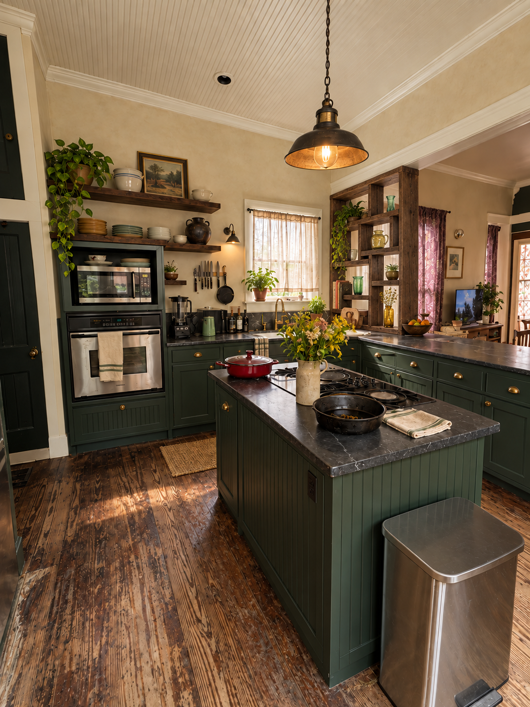

# Trade Journal: TV Room

## The Challenge

The TV Room is the next room Shawn plans to work on in the 1894 residence.
The opening decision is to remove the kitchen upper cabinets and replace them
with the open wood shelving partition chosen in the project chat
"Reimagine kitchen without uppers."

## Existing Conditions And Design Context

In the October 23, 2026 discussion, Shawn described the kitchen ceiling as
beadboard and the adjoining sitting-room ceiling as drywall. The existing
uppers are mounted beneath the horizontal partition at that transition.
He estimated that partition's width at 26–36 inches; this is an unmeasured
estimate, not a shelf dimension.

Shawn wants to retain the dropped header above the wider opening because it
provides the transition between the two ceiling finishes. Its structural role
has not been established. Exact measurements and sketches are planned before
the room work begins.

## Selected Shelving Direction

The chosen reference uses dark wood and staggered, asymmetrical rectangular
openings. The shelves form an open-through partition in the narrow bay beside
the sink window, with views into the adjoining room and the wider opening
beside it left clear. The shelving stops beneath the retained dropped header,
which continues above the wider opening.

The exact image Shawn attached when confirming his choice on October 23 is
preserved below. It is the reference for the partition's appearance. Wood
species, stock sizes, joinery, fastening, and finish products remain to be
specified in the measured design.

## Journal Entries

### 2026-11-13 - TV Room Journal Opened

Shawn named the next room project **TV Room** and began its journal with the
decision to remove the uppers and use the shelving partition selected in
"Reimagine kitchen without uppers." The earlier design discussion and exact
selected image establish the starting direction for this room's record.

After reviewing the exact image again, Shawn confirmed it as the chosen
partition on November 13. The shelving will stop beneath the retained header
as shown. This confirmation supersedes the earlier ceiling-height description.

This entry records planning. Cabinet removal, partition construction, and
installation have not yet been recorded.

## Visual Reference

### Preferred Partition Concept Confirmed October 23 2026

This is a generated design visualization selected by Shawn, not a photograph
of completed work. It records the shelving composition and retained header;
the other kitchen finishes shown are not specifications for the TV Room.

## Current Stage And Next Records

The project is at the initial planning stage. The next records are the exact
measurements and sketches Shawn plans to make, followed by photographs of the
existing room, cabinet attachments, and ceiling transition before removal.

The selected concept is confirmed. Final dimensions and the shelf-to-header
junction will follow the measured sketches.
